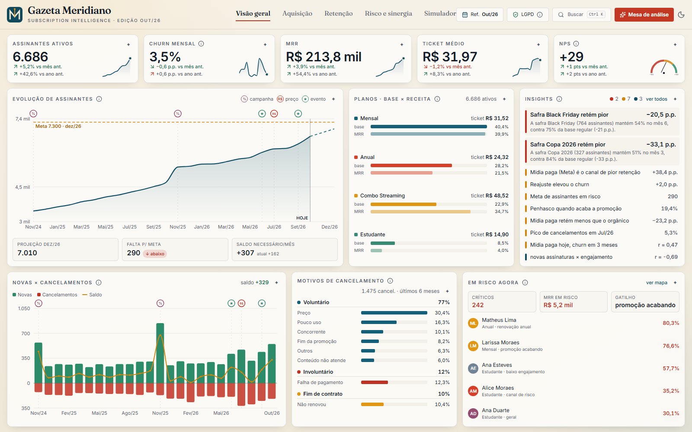
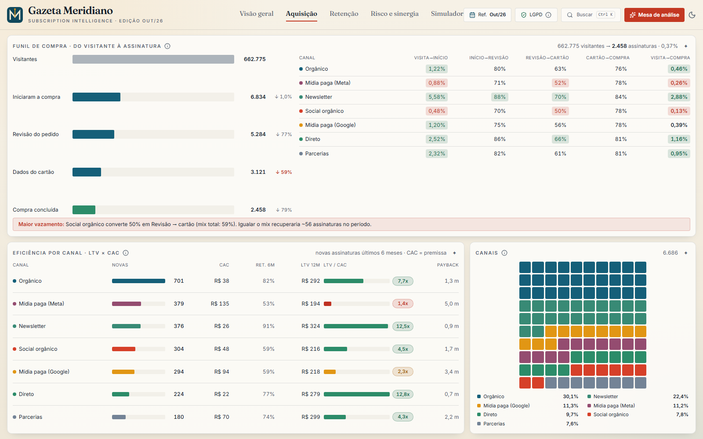
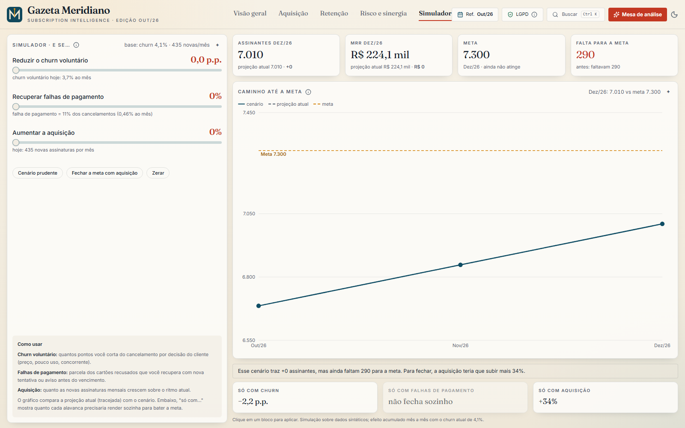

# Meridiano Subscriber Compass

Dashboard de **inteligência de assinaturas digitais (B2C)** para a *Gazeta Meridiano*, um jornal **fictício**. Reúne funil de compra, unit economics, retenção, risco de cancelamento e um simulador "e se", com uma **Mesa de análise (Modo IA)** que responde perguntas de negócio sem calcular número nenhum por conta própria.

[](https://gazetameridiano.app)
[](https://gazetameridiano.app/?demo=1)




> Todos os dados são **100% sintéticos**, gerados no navegador por uma simulação determinística (seed fixa). Não há nenhuma informação real de assinantes (LGPD).

## Demo

- **Painel:** <https://gazetameridiano.app>
- **Modo demo automático** (roteiro de cerca de 45 s, com cursor e legendas): <https://gazetameridiano.app/?demo=1>

## O que o painel responde

| Tema | O que mostra |
| --- | --- |
| **Aquisição** | Funil de ponta a ponta (visitantes → início da compra → revisão → cartão → compra) por canal, o maior vazamento e quantas assinaturas seriam recuperadas. CAC, LTV de 12 meses, LTV/CAC e payback por canal. |
| **Receita** | Ponte de MRR (novas, fim de promoção, reajuste, upgrades, cancelamentos) e mix de planos (base × receita). |
| **Retenção** | Churn por natureza e motivo, curva de permanência por safra (Kaplan-Meier, que trata censura à direita) e risco de cancelamento por assinante. |
| **Simulador** | Três alavancas (churn voluntário, recuperação de falha de pagamento, aquisição) sobre a mesma projeção do painel, com o que bastaria sozinho para bater a meta. |
| **Apoio à leitura** | Notas por mês nos gráficos, **Pauta do dia** (achados priorizados) e busca com **Ctrl/⌘ + K**. |

| Aquisição | Simulador |
| --- | --- |
|  |  |

## Mesa de análise (Modo IA)

Clique num card e o painel gera leituras ligadas a ele, com sugestões de próxima pergunta. É um **roteador de intenções sobre um motor determinístico**: a IA nunca calcula números, só escolhe a análise, ordena e redige a resposta.

```text
pergunta → roteador de perguntas → motor de métricas → resposta redigida
```

Responde, por exemplo: "qual o CAC por canal?", "vale a pena mídia paga?", "onde perco mais no funil?", "e se o churn cair 1 ponto?" e "baixar o preço melhora o churn?" (aqui ela mostra o limite do efeito e o custo, sem fingir causalidade).

## Arquitetura

```text
src/
├── engine/        funções puras sobre o dataset: geração, métricas, funil,
│                  unit economics, what-if, notas, insights e roteadores de perguntas
├── components/
│   ├── ai/        Mesa de análise e cards gerados
│   ├── dashboard/ gráficos e cards do painel
│   ├── demo/      roteiro do modo demo
│   ├── shell/     navegação, barra de comandos, tema
│   ├── ui/        componentes base (shadcn/ui)
│   └── views/     as abas do painel
├── hooks/
├── lib/           dados do painel, formatação, utilitários
├── routes/        rotas (TanStack Start, baseadas em arquivos)
└── test/          testes (vitest)
```

O motor (`src/engine`) concentra toda a conta. A interface só apresenta: os componentes não fazem matemática de negócio.

## Limites assumidos

CAC e as taxas de visitante, revisão e cartão são **premissas sintéticas** por canal. Não há teste de preço nos dados, então a elasticidade não é medida.

## Rodar localmente

```bash
bun install      # ou npm install
bun dev          # ou npm run dev
```

## Testes

```bash
bun run test     # ou npm test (vitest)
```

São 13 arquivos de teste, cobrindo o motor de métricas, os roteadores de perguntas, as legendas e o roteamento da aplicação.

## Stack

TanStack Start, React 19, Vite, TypeScript, Tailwind CSS, shadcn/ui (Radix), Recharts, framer-motion e Vitest.

## Documentação

- [Roadmap](docs/roadmap.md)

## Licença

[MIT](LICENSE) © 2026 Gabriel Rangel

## Autor

**Gabriel Rangel**, analista de dados e automação com IA. Mais projetos em [gabriel-rangel.vercel.app](https://gabriel-rangel.vercel.app).
